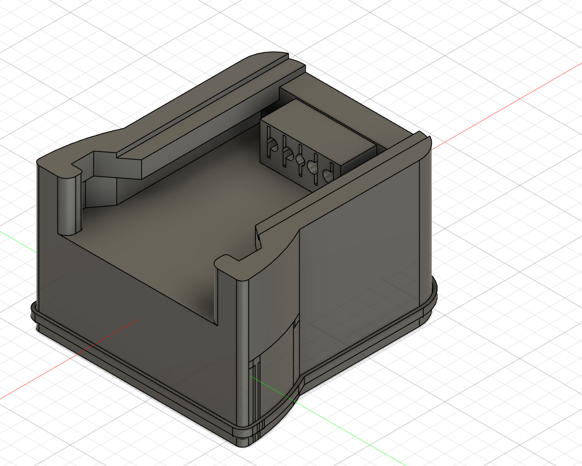
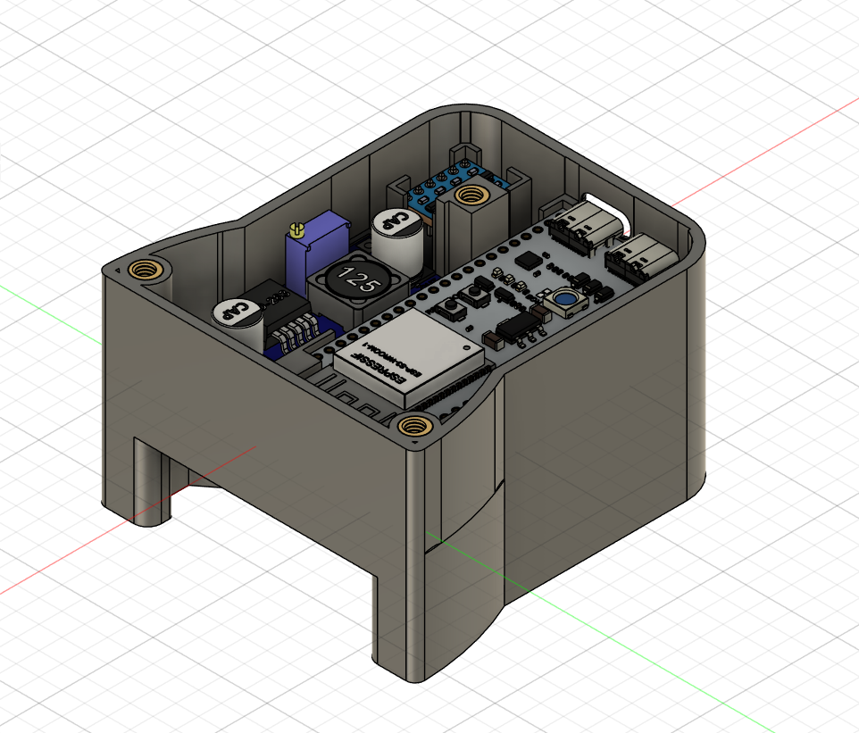
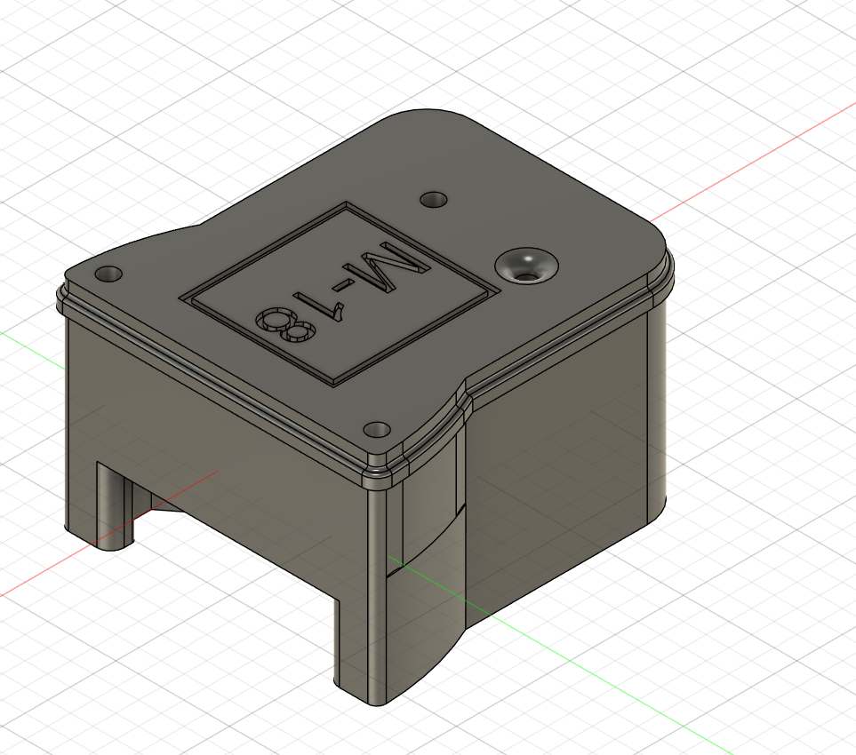
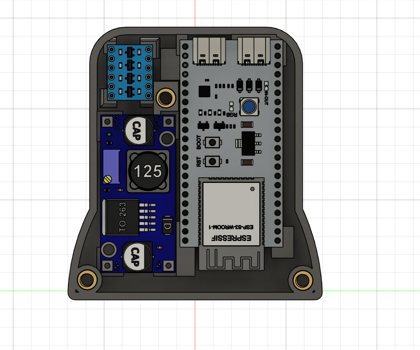
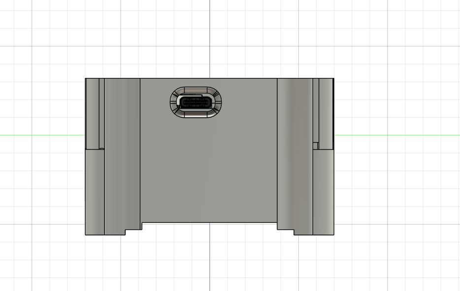
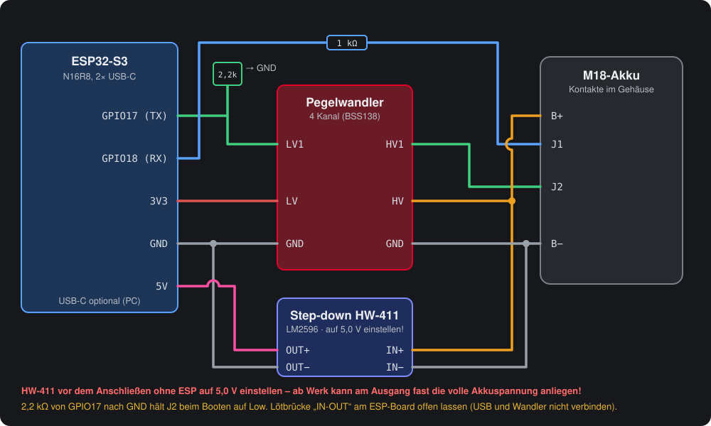

# Aufsteckgehäuse für die ESP32-S3-Brücke

Das Gehäuse wird **wie ein Werkzeug auf den M18-Akku geschoben**. Vier Kontakte greifen B+, J1, J2 und B− ab.
Im Gehäuse sitzen ESP32-S3, Pegelwandler und ein Step-down-Wandler, der den ESP **aus dem Akku versorgt**.
Seitlich ist eine USB-C-Buchse für den PC zugänglich. Ein Kabel zum Akku braucht man so nicht mehr: aufstecken, Handy oder PC verbinden, auslesen.

| Akku-Seite mit Schienen und Kontaktblock | Elektronikraum |
|---|---|
|  |  |
| **Geschlossen mit Deckel** | **Bestückung von oben** |
|  |  |

## Grundlage

Die Akku-Aufnahme (Schienen und Kontaktblock) basiert auf dem Modell
**[„Milwaukee M18 All Pins“ auf Printables](https://www.printables.com/model/1425816-milwaukee-m18-all-pins)**.
Darauf aufgebaut sind der Elektronikraum für ESP32-S3, Pegelwandler und Step-down, die USB-C-Öffnung, die Gewindeeinsätze und der Deckel.
Für die Akku-Aufnahme gelten die Lizenzbedingungen des Originalmodells (siehe Printables-Seite).

## Dateien

| Datei | Inhalt |
|---|---|
| `druckplatte-bambu-studio.3mf` | Bambu-Studio-Projekt: Gehäuse und Deckel auf einer Platte, mit Druckeinstellungen |
| `gehaeuse.3mf` | nur das Gehäuse |
| `gehaeuse.stl`, `deckel.stl` | für andere Slicer (PrusaSlicer, Cura, OrcaSlicer …) |
| `m18-bruecke-gehaeuse.f3z` | Fusion-360-Quelldatei mit den eingesetzten Bauteilmodellen (ESP32-S3-Board, HW-411, Pegelwandler, Gewindeeinsätze) |

Maße: Gehäuse 75 × 70 × 44 mm, Deckel 72,5 × 77,6 × 10,8 mm.

## Stückliste

| Anzahl | Teil | Hinweis |
|---|---|---|
| 1 | ESP32-S3-Board **N16R8** mit 2× USB-C | Layout wie ESP32-S3-DevKitC-1 (z. B. „YD-ESP32-S3“) |
| 1 | Pegelwandler 4 Kanal (BSS138) | LV = 3,3 V, HV = B+ |
| 1 | Step-down **HW-411** (LM2596) | Eingang 4,5–40 V, **auf 5,0 V einstellen** |
| 3 | Gewindeeinsatz **ruthex RX-M4x8.1** | mit dem Lötkolben einpressen |
| 3 | Schraube M4 | Länge an Deckel + Einsatz anpassen |
| 4 | Kontakte für B+, J1, J2, B− | im Kontaktblock des Gehäuses |
| 1 | Widerstand 1 kΩ | J1 → GPIO18 |
| 1 | Widerstand 2,2 kΩ | GPIO17 → GND (J2 beim Booten auf Low) |
| – | Litze 0,25–0,5 mm² | B+/B− zum Wandler etwas dicker |

## Drucken

Die Einstellungen aus dem Bambu-Projekt (X1 Carbon, 0,4-mm-Düse) passen auch für andere Drucker:

- Schichthöhe **0,2 mm**
- **4 Wände**, oben/unten je 6 Schichten
- Infill **15 % Grid**
- **Tree-Support (auto)** für den Kontaktblock und die Schienen
- Material im Projekt: **PLA Matte**

Für den Einsatz im Fahrzeug (Transporter im Sommer) ist **PETG oder ASA** besser, denn PLA wird ab etwa 55 °C weich.
Gehäuse und Deckel so drucken, wie sie im Projekt liegen.

## Zusammenbau

1. **Gewindeeinsätze** mit dem Lötkolben einsetzen (für PLA ca. 220–240 °C, gerade und bündig).
2. **Step-down zuerst allein einstellen:** HW-411 an den Akku (oder ein Netzteil 12–20 V) anschließen, **ohne ESP**.
   Mit dem Multimeter am Poti auf **5,0 V** drehen. Ab Werk kann am Ausgang fast die volle Eingangsspannung anliegen, und die zerstört den ESP.
3. **Firmware vorher flashen** über USB (Einstellungen siehe [esp32-bridge/README.md](../../esp32-bridge/README.md)).
4. **Verdrahten** nach Plan:

   

   - GPIO17 → Pegelwandler LV1, HV1 → **J2**; 2,2 kΩ von GPIO17 nach GND
   - **J1** → 1 kΩ → GPIO18
   - 3V3 → LV, **B+** → HV und HW-411 IN+
   - **B−** → GND (Pegelwandler, HW-411 IN− und OUT−, ESP)
   - HW-411 OUT+ (5,0 V) → **5V-Pin** des ESP
5. **Erster Test ohne Akku** über USB: Weboberfläche öffnen, unter *Gerät → Status-LED* auf „Testen“ drücken.
6. **Mit Akku:** Gehäuse aufschieben und mit dem Multimeter prüfen: **J2 gegen B− unter 1 V**. Danach in der Weboberfläche *Gerät → Akku testen*.
7. Deckel aufschrauben.

## Wichtig

- **Stromverbrauch aus dem Akku:** Solange das Gehäuse steckt, versorgt der Akku die Elektronik.

  | Zustand | Verbrauch (geschätzt, bitte nachmessen) |
  |---|---|
  | wach, im WLAN | ca. 30–40 mA bei 18 V → ein 5-Ah-Akku ist in etwa einer Woche leer |
  | Energiesparmodus (Tiefschlaf) | ca. 5–8 mA (Eigenverbrauch HW-411 plus Pull-up des Pegelwandlers an B+) |

  Die Firmware geht nach einstellbarer Ruhezeit in den **Tiefschlaf** (Standard 30 min, *Gerät → Energiesparen*). J2 bleibt dabei auf Low.
  **Aufwecken mit der BOOT-Taste** oder durch Abziehen und erneutes Aufstecken.
  Auch im Schlaf fließen noch einige mA. **Nach Gebrauch abziehen** oder einen **Schalter** in die B+-Leitung zum Wandler einbauen.
  Ein Wandler mit geringerem Eigenverbrauch hilft zusätzlich.
- **Lötbrücke „IN-OUT“** am ESP-Board (falls vorhanden) **offen lassen**. Sonst wären die 5 V des Wandlers direkt mit dem USB-Anschluss des PCs verbunden.
- **Status-LED bleibt dunkel?** Auf manchen Boards muss die Lötbrücke „RGB“ geschlossen werden. Außerdem *Gerät → Status-LED* auf GPIO48 bzw. 38 prüfen.
- Hinter der USB-C-Öffnung liegt eine der beiden Buchsen des Boards. Mit „USB CDC On Boot: Enabled“ nimmt die Firmware Befehle auf **beiden** Buchsen an,
  die PC-Software funktioniert also an jeder.
- Die Brücke kann den Akku nur **lesen** und die Notiz schreiben. Arbeiten an Li-Ion-Akkus geschehen auf eigene Gefahr.
