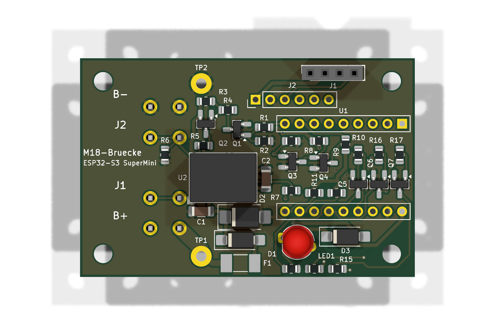
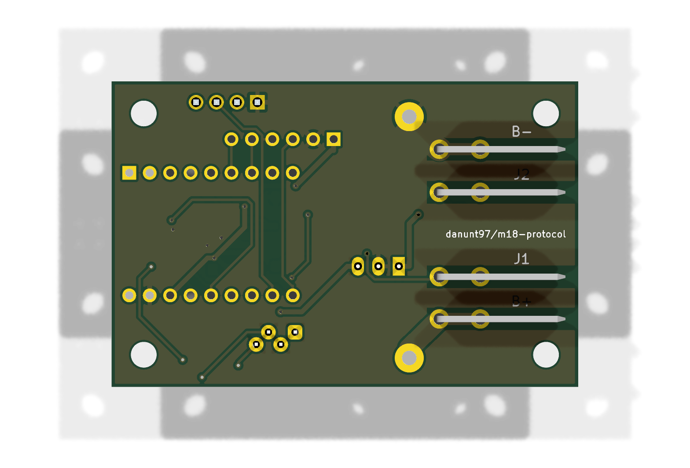
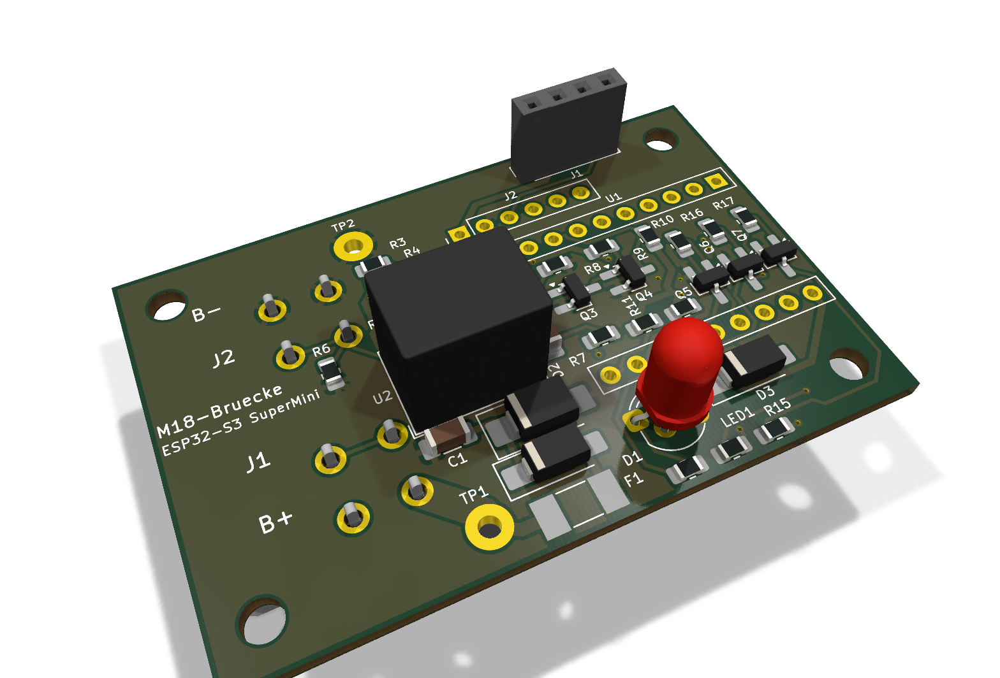

# Platine: M18-Brücke mit ESP32-S3 SuperMini

Eigene Leiterplatte für die [Akku-Brücke](../../esp32-bridge/README.md). Die vier Akkukontakte sitzen direkt auf der Platine. Der SuperMini wird mit seinen mitgelieferten Stiftleisten direkt eingelötet. Der Pegelwandler ist durch zwei kleine Transistorstufen ersetzt, der
Step-down-Wandler durch einen RECOM-Schaltregler. Alles ist von Hand lötbar (SMD ab 0805 / SOT-23 / SMA).

| Oben | Unten (Akkuseite) |
|---|---|
|  |  |

> **Stellen mit ⚠ PRÜFEN** beruhen auf Annahmen, weil Datenblatt, Pinbelegung oder Foto beim Entwurf fehlten.
> Bitte vor der Bestellung der 20 Platinen kontrollieren (Liste ganz unten).

## Eckdaten

| | |
|---|---|
| Größe | **58 × 38 mm**, 2 Lagen, 1,6 mm, 35 µm Kupfer |
| Befestigung | 4 × **M3** (Bohrung 3,2 mm), Mitte 4 mm von den Kanten, Lochabstand **50 × 30 mm** |
| Akkukontakte | 4 × TE **928814-1** (FASTON 6,35 × 0,81 mm) auf der **Unterseite**, Messerspitzen bündig mit der linken Kante |
| Versorgung | aus dem Akku (B+ 15–21 V) oder über USB-C des SuperMini |
| Ruhestrom aus B+ | nur der Eigenverbrauch des Reglers (R-78E, Wert im Datenblatt nachsehen und am Muster messen) und der Schlafstrom des ESP. Die J2-Stufe zieht im Ruhezustand nichts. |
| Laden | vorbereitet: Lötlöcher CHG+/CHG− für 1,5-mm²-Litze und 6-poliger Steuerstecker, nichts bestückt |

Bezugspunkt aller Maße ist die linke obere Ecke der Draufsicht (x nach rechts = Einsteckrichtung, y nach unten).

## Akkukontakte

Draufsicht, Messerspitzen links (zeigen zum Akku hin):

| Kontakt | Bauteil | Mitte y | Abstand zum Nachbarn |
|---|---|---|---|
| **B−** | X4 | 8,45 mm | – |
| **J2** | X3 | 13,80 mm | 5,35 mm |
| **J1** | X2 | 24,30 mm | 10,50 mm |
| **B+** | X1 | 29,55 mm | 5,25 mm |

- Von oben in Einsteckrichtung gesehen, Spitzen nach vorne: **links B+, J1, J2, rechts B−**.
- Die Abstände sind aus dem bisherigen Gehäuse übernommen, also aus den Schlitzen im STL des Printables-Modells „Milwaukee M18 All Pins“.
  Gemessen wurden Schlitzmitten bei −10,55 / −5,20 / 0 / +5,30 / +10,55 mm. Der mittlere Schlitz bleibt frei.
- Die Lötstifte liegen bei x = 12,18 und 17,26 mm, das Messer reicht von x = 0,7 bis 16,7 mm. Es ist 6,35 mm hoch und steht senkrecht auf der Unterseite.
- Unter den Messern ist auf der Unterseite keine Kupferfläche (Sperrflächen), damit kein Messer auf einer Massefläche aufliegt.
  Oben über den Messern sitzen nur SMD-Teile, die Unterseite bleibt dort glatt.
- ⚠ **PRÜFEN:** Ohne TE-Datenblatt stammen Lochbild und 3D-Modell aus dem SamacSys-Modell in `quellen/LIB_928814-1`.
  Höhe und Lage des Messers am ersten Muster mit dem Akku ausprobieren, bevor das Gehäuse fertig konstruiert wird.

## Pinbelegung ESP32-S3 SuperMini

Draufsicht auf den SuperMini, USB-C zeigt nach rechts (Platinenkante). Reihenabstand 15,24 mm, je 9 Pins.

| Pin | Obere Reihe (y = 11,38) | Funktion | Untere Reihe (y = 26,62) | Funktion |
|---|---|---|---|---|
| 1 / 10 (USB-Seite) | GPIO43 (U0TXD) | frei | 5V | Versorgung über D3 (B140) aus dem Regler |
| 2 / 11 | GPIO44 (U0RXD) | frei | GND | Masse = B− |
| 3 / 12 | GPIO1 | frei | 3V3 | Versorgung OLED, Pull-ups, Steuerstecker |
| 4 / 13 | GPIO2 | frei | GPIO13 | RGB-LED **rot** (Q5 → Pad 1) |
| 5 / 14 | GPIO3 (Strapping) | frei | GPIO12 | RGB-LED **blau** (Q6 → Pad 4) |
| 6 / 15 | GPIO4 | **Reserve** → Steuerstecker Pin 6 | GPIO11 | RGB-LED **grün** (Q7 → Pad 3) |
| 7 / 16 | GPIO5 | **CHG_EN** → Steuerstecker Pin 5 | GPIO10 | frei |
| 8 / 17 | GPIO6 | **RX** ← J1-Stufe | GPIO9 | **SCL** (4,7 kΩ Pull-up) |
| 9 / 18 | GPIO7 | **TX** → J2-Stufe | GPIO8 | **SDA** (4,7 kΩ Pull-up) |

- Onboard-WS2812 des SuperMini: GPIO48. BOOT-Taste: GPIO0.
- Die Pinbelegung stammt von [espboards.dev](https://espboards.dev/esp32/esp32-s3-super-mini/) und stimmt mit dem Pinout-Bild
  des bestellten Boards überein (Heemol ESP32-S3 Mini, Aufdruck „Super Mini ESP32-S3 HW-747“).
  ⚠ **PRÜFEN:** Den Reihenabstand von 15,24 mm (Board 18 mm breit) habe ich angenommen. Am Board nachmessen, bevor die Platinen bestellt werden.

## Steckverbinder und Lötpunkte

| Bauteil | Pin 1 → n | Hinweis |
|---|---|---|
| **J1** OLED, Buchse 1×4 (Harwin M20-7820442) | **GND, VCC (3V3), SCL, SDA** | Von oben gesehen von links nach rechts, Pin 1 (GND) ist das eckige Pad links. Passt zum QIQIAZI-0,96″-Modul (Aufdruck GND VCC SCL SDA). Das Display schaut über den SuperMini. |
| **J2** Lade-Steuerung, Stiftleiste 1×6 | 3V3, GND, SDA, SCL, CHG_EN, Reserve (GPIO4) | **nicht bestücken** (DNP) |
| **TP1** CHG+ | B+ direkt am Akkukontakt, **vor** der Sicherung | Lötloch 1,8 mm, für ~5 A |
| **TP2** CHG− | B− direkt am Akkukontakt | Lötloch 1,8 mm, für ~5 A |

Die Ladeleitungen sind breit ausgeführt:
- **B+ → CHG+:** 2,5 mm auf beiden Lagen.
- **B− → CHG−:** 3 mm auf der Unterseite plus Massefläche.

Der Ladestrom fließt **nicht** durch F1. Eine spätere Ladeplatine braucht deshalb ihre eigene Absicherung.

## Schaltung

Schaltplan: [`m18-bruecke.kicad_sch`](m18-bruecke.kicad_sch), als PDF in [`fertigung/m18-bruecke-schaltplan.pdf`](fertigung/m18-bruecke-schaltplan.pdf).

**Versorgung**
- **Pfad:** B+ → **F1** 500 mA träge (Littelfuse 0452.500MRL) → **D1** B1100 (Verpolschutz) → VBAT.
- **Schutz und Puffer an VBAT:** TVS **D2** SMBJ24A und **C1** 4,7 µF/50 V.
- **Regler:** **U2** R-78E5.0-0.5 macht aus VBAT 5 V (C2 10 µF). **D3** B140 führt die 5 V zum 5V-Pin des SuperMini.
- **USB und Regler gleichzeitig:** D3 verhindert, dass USB in den Regler zurückspeist. Der Regler liefert hinter D3 nur ~4,6 V und
  liegt damit unter der USB-Spannung, er speist also auch nicht in den PC. Das Arbeiten gegeneinander, das beim DevKit die Lötbrücke „IN-OUT“
  verursacht hat, fällt weg.

**J2 – Senden** (Q1 MMBT3904, Q2 MMBT3906, nicht invertierend: TX high → J2 = B+)
- **Ansteuerung:** GPIO7 → R1 2,2 kΩ → Basis Q1. **R2 4,7 kΩ** zieht die Basis nach GND. Auch mit dem internen Pull-up des ESP
  beim Booten bleibt die Basis unter 0,3 V, J2 bleibt also low.
- **High-Side-Schalter:** Q1 schaltet über R4 10 kΩ die Basis von Q2. R3 10 kΩ hält Q2 gesperrt. Q2 legt B+ (VBAT) über **R5 1 kΩ** an J2.
- **Low-Pegel:** **R6 10 kΩ** zieht J2 nach B−, wenn Q2 aus ist.
- **Strom:** Im Ruhezustand fließt kein Strom aus B+. Bei J2 = high sind es ca. 4 mA, davon 2 mA in die Basis von Q2 und ~2 mA durch R6.
- Die Firmware bleibt gleich: Der UART-TX ist im Ruhezustand invertiert (= low), genau wie mit dem Pegelwandler.

**J1 – Empfangen** (Q3, Q4 MMBT3904 wie im Spud-Isolator `docs/spud_isolator.png`, nicht invertierend)
- J1 → R7 15 kΩ → Basis Q3, R8 100 kΩ nach GND (nur damit ein offener Kontakt nicht schwebt).
- Q3 zieht die Basis von Q4 auf Low, R9 15 kΩ Pull-up auf 3,3 V. Q4 zieht RX (GPIO6) auf Low, R10 10 kΩ Pull-up auf 3,3 V.

**RGB-LED** (5 mm, gemeinsame Anode; bestellt: Lumetheus RGB, Pinfolge R, A, G, B)
- Grün und Blau brauchen ~3,2 V und gehen deshalb nicht an 3,3 V. Die Anode liegt an +5 V, jede Kathode an einem MMBT3904 (Q5–Q7, Basis 2,2 kΩ).
- Vorwiderstände: rot 270 Ω, grün/blau 150 Ω, das ergibt ca. 7–9 mA bei voller Helligkeit.
- Die Firmware zeigt auf der LED dieselben Farben wie auf der WS2812.
- Pinfolge: Rot kommt ins eckige Pad 1, die Anode (längster Pin) in Pad 2, dann Grün (Pad 3, GPIO11) und Blau (Pad 4, GPIO12).
  So ist die Lumetheus-LED belegt, und so sind Schaltplan und Firmware ausgelegt. Eine Dialight 521-8559F hat Blau und Grün vertauscht (R, A, B, G).
  Mit ihr in `m18_bridge.ino` `PIN_RGB_G` und `PIN_RGB_B` tauschen.
- Hinweis: Die Basen von Q5–Q7 haben keinen Pull-down. Beim Einschalten kann die LED kurz schwach glimmen, bis die Firmware die Pins setzt.
  Im Tiefschlaf hält die Firmware die Pins auf Low.

## Firmware

Variante `BOARD_SUPERMINI` (TX = GPIO7, RX = GPIO6, RGB-LED an GPIO13/12/11, CHG_EN = GPIO5 low, 4 MB Flash, PSRAM quad),
siehe [esp32-bridge/README.md](../../esp32-bridge/README.md#variante-eigene-platine-mit-esp32-s3-supermini).
Im [Web-Flasher](https://danunt97.github.io/m18-protocol/) gibt es dafür einen eigenen Knopf „ESP32-S3 SuperMini“.

## Fertigung

| Datei | Inhalt |
|---|---|
| [`fertigung/m18-bruecke-gerber.zip`](fertigung/m18-bruecke-gerber.zip) | Gerber (X2) und Bohrdateien (Excellon, mm, PTH/NPTH getrennt) – so beim Leiterplattenhersteller hochladen |
| `fertigung/gerber/` | dieselben Dateien ausgepackt, dazu die Bohrpläne als PDF |
| [`fertigung/m18-bruecke-bestellliste.xlsx`](fertigung/m18-bruecke-bestellliste.xlsx) | Stückliste für 20 Platinen: Mouser-Teile mit Hersteller- und Mouser-Nummern, dazu SuperMini, RGB-LED und OLED von Amazon (Blatt „Sonstiges“) |
| `fertigung/m18-bruecke-bestueckung-oben.pdf` / `-unten.pdf` | Bestückungsplan (alle Referenzen, auch die, die im Bestückungsdruck keinen Platz haben) |
| `fertigung/m18-bruecke-schaltplan.pdf` | Schaltplan |

Einstellungen beim Hersteller: 2 Lagen, 1,6 mm FR4, 1 oz Kupfer, HASL oder ENIG. Minimale Werte im Design: Leiterbahn 0,3 mm,
Abstand 0,2 mm, Via 0,7/0,35 mm, Kupfer zum Rand 0,4 mm.

**Prüfung:** ERC 0 Fehler/Warnungen. DRC (alle Schweregrade) 0 Verstöße, 0 offene Verbindungen, Schaltplan und Platine stimmen überein.

### Bestücken

1. SMD-Teile oben (Widerstände, Transistoren, Dioden, C1/C2, F1). **Die Teile unter dem SuperMini** (Q3–Q7, R7–R10, R16–R18)
   müssen vor dem SuperMini drauf und kontrolliert sein, später kommt man nicht mehr heran.
2. R-78E (U2) und die OLED-Buchse.
3. SuperMini mit seinen **mitgelieferten Stiftleisten direkt einlöten** (kein Sockel). Die Stiftleisten zuerst in die Platine stecken,
   SuperMini auflegen, oben und unten verlöten. Der Kunststoffhalter der Stiftleiste (~2,5 mm) ist der Abstand zu den SMD-Teilen darunter.
   Am besten vorher die Firmware über den Web-Flasher aufspielen und den SuperMini einmal testen.
4. RGB-LED: Die Pads sind versetzt. Die vier Beinchen leicht abwechselnd nach vorne und hinten biegen. Der lange Anschluss (Anode) gehört an Pin 2.
5. Zuletzt die vier Akkukontakte von **unten** einsetzen und oben verlöten. Die Messer müssen senkrecht stehen.
6. Erster Test am Netzteil (12–20 V an B+/B−, Strom auf 100 mA begrenzen): am 5V-Pin ~4,6 V, die LED zeigt den WLAN-Status.
   Am besten schon nach Schritt 2 (vor dem SuperMini) einmal die 4,6 V an den Lötaugen von Pin 5V prüfen.
7. Mit Akku prüfen: **J2 gegen B− unter 1 V**.

## ⚠ Vor der Bestellung prüfen

1. **Reihenabstand des SuperMini** (15,24 mm) am echten Board nachmessen. Die Pinbelegung ist geprüft.
2. **Kontaktreihenfolge**: links B+, J1, J2, rechts B−, von oben in Einsteckrichtung gesehen. Sonst sind B+ und B− vertauscht.
   D1 schützt dann zwar die Elektronik, die Brücke funktioniert aber nicht.
3. **TE 928814-1**: Datenblatt fehlte, Maße aus dem SamacSys-Modell. Lochdurchmesser 1,45 mm und Messerhöhe prüfen.
4. **Mengen im Mouser-Warenkorb** gegen die Bestellliste prüfen (Bedarf für 20 Platinen).
5. **J2-Pegel**: R6 10 kΩ zieht J2 im Ruhezustand nach B−. Falls der Akku J2 intern stark nach oben zieht, R6 verkleinern (z. B. 4,7 kΩ). Am Muster messen.
6. **Höhe**: R-78E ~10 mm, SuperMini ~2,5 mm über der Platine (plus USB-C-Buchse), OLED-Buchse 8,5 mm, RGB-LED 8,6 mm. Für das neue Gehäuse aus dem 3D-Modell (`m18-bruecke.kicad_pcb`, 3D-Ansicht) übernehmen.

## Dateien

| Datei | Inhalt |
|---|---|
| `m18-bruecke.kicad_pro/.kicad_sch/.kicad_pcb` | KiCad-10-Projekt |
| `lib/m18.kicad_sym`, `lib/m18.pretty`, `lib/3d` | Projektbibliothek: SuperMini-Lochbild (2 × 9, Footprint „ESP32-S3_SuperMini_Sockel“), TE 928814-1, Harwin-Buchse, RGB-LED (KiCad-Footprint ohne den Silk-Bogen an Pad 4), Lötloch |
| `quellen/` | Herstellerbibliotheken (TE 928814-1, Dialight 521-8559F, Harwin M20-7820442) |
| `tools/` | Skripte, mit denen die Platine entstanden ist (KiCad-Python). **`neu_routen.sh`** baut alles neu auf: Netze und Felder aus dem Schaltplan, Bauteillage (`lage.py`), feste Leitungen (`vorrouten.py`: Akkuleitungen, Q3B, GND-Via an Q5), Freerouting, GND-Flächen und Sperrflächen (`flaechen.py`), Bestückungsdruck (`beschriftung.py`), ERC/DRC, Gerber, PDFs, Bilder und Bestellliste. KiCad vorher schließen. |

Geroutet wurde mit [Freerouting](https://github.com/freerouting/freerouting) 2.2.4 (braucht Java 25, erwartet unter `~/.kicad-mcp/`).
Die Akkuleitungen sind von Hand gelegt und gesperrt. Wer in KiCad von Hand weiterarbeitet, braucht die Skripte nicht. `neu_routen.sh` würde Handänderungen an Leiterbahnen überschreiben.
